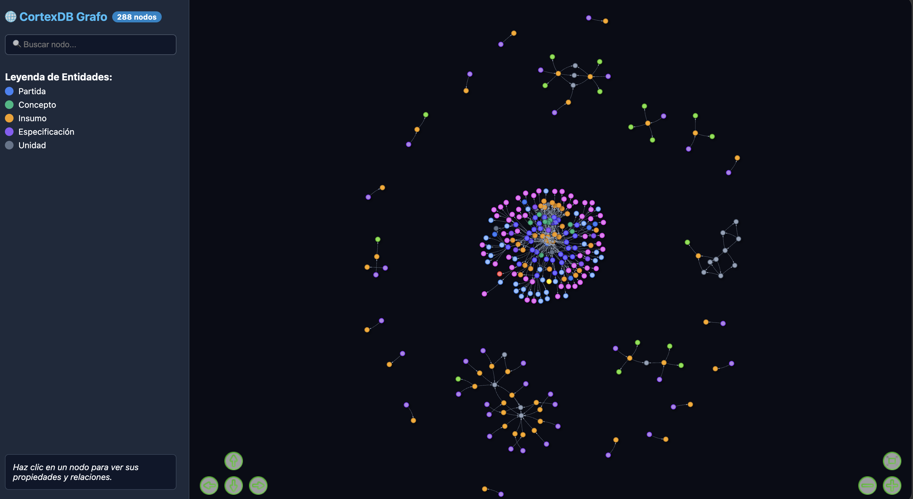
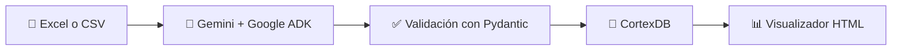

<div align="center">

# 🏗️ Catálogos de obra a grafos de conocimiento

**Convierte renglones de un catálogo de obra en un grafo consultable con Gemini, Google ADK y CortexDB.**




</div>

> 📝 Este repositorio es el código de acompañamiento de un artículo. Está pensado para leerse y ejecutarse en local, no para producción.

## 📑 Contenido

- [💡 Qué hace](#-qué-hace)
- [📁 Estructura del proyecto](#-estructura-del-proyecto)
- [✅ Requisitos](#-requisitos)
- [⚙️ Instalación](#️-instalación)
- [🚀 Ejecución](#-ejecución)
- [📊 Explorar el grafo](#-explorar-el-grafo)
- [🧹 Reiniciar la base de datos](#-reiniciar-la-base-de-datos)

## 💡 Qué hace

Cada renglón del catálogo pasa por un modelo de Gemini, que devuelve un grafo validado con Pydantic. El grafo se guarda en CortexDB y se puede explorar en una página HTML interactiva.



El grafo usa cinco tipos de nodo y cuatro relaciones:

| Origen | Relación | Destino |
|---|---|---|
| Partida | `contiene` | Concepto |
| Concepto | `se mide en` | Unidad |
| Concepto | `incluye` | Insumo |
| Concepto | `cumple` | Especificación |

## 📁 Estructura del proyecto

```text
cortexdb/
├── 🤖 agent/                  # Agente conversacional para ADK Web
│   ├── agent.py               # Define root_agent y sus instrucciones
│   ├── tools.py               # Herramientas que el agente puede llamar
│   ├── extractor.py           # Extracción del grafo con Gemini
│   ├── cortex.py              # Conexión y guardado en CortexDB
│   ├── excel_reader.py        # Lectura de Excel y CSV
│   ├── models.py              # Esquemas Pydantic del grafo
│   ├── run.py                 # Demo con renglones de ejemplo, sin interfaz
│   └── visualizador.py        # Genera grafo.html desde CortexDB
├── 📜 scripts/                # Versión simple del flujo, por terminal
│   ├── main.py                # Lee el catálogo, extrae, guarda y visualiza
│   ├── schemas_nodos.py       # Esquemas Pydantic del grafo
│   └── visualizador.py        # Genera grafo_resultado.html
├── 📊 data_set/               # Catálogo de obra de muestra (.xlsx y .tsv)
├── 🧪 ejemplo.py              # Ejemplo mínimo en un solo archivo
├── 🖼️ poster.png              # Imagen de este README
└── 📦 pyproject.toml          # Dependencias del proyecto
```

## ✅ Requisitos

- 🐍 **Python 3.13** o superior
- ⚡ **[uv](https://docs.astral.sh/uv/)** para gestionar el entorno
- 🐹 **[Go](https://go.dev/)** para instalar el servidor de CortexDB
- 🔑 **[API key de Google AI Studio](https://aistudio.google.com/app/apikey)** para usar Gemini

Las instrucciones son para macOS y Linux.

## ⚙️ Instalación

**1. Instala `uv`, si aún no lo tienes**

```bash
curl -LsSf https://astral.sh/uv/install.sh | sh
```

**2. Instala las dependencias de Python**

```bash
uv sync
```

**3. Instala el servidor de CortexDB**

```bash
go install github.com/liliang-cn/cortexdb/v2/cmd/cortexdb-grpc@latest
```

El binario queda en `~/go/bin/cortexdb-grpc`. Este proyecto usa la versión `v2.145.0`; `@latest` puede instalar una más reciente.

**4. Crea un archivo `.env` en la raíz del proyecto**

```bash
GOOGLE_API_KEY=tu_google_api_key_aqui
GOOGLE_GENAI_MODEL=gemini-2.5-flash
CORTEXDB_ADDR=127.0.0.1:47821
CORTEXDB_GRPC_TOKEN=
```

> ⚠️ `.env` contiene tu clave y ya está en `.gitignore`. No lo subas al repositorio.

## 🚀 Ejecución

### 1️⃣ Inicia CortexDB

Déjalo corriendo en una terminal aparte:

```bash
~/go/bin/cortexdb-grpc -token "" -http-addr "127.0.0.1:8080"
```

Comprueba desde otra terminal que responde:

```bash
~/go/bin/cortexdb-grpc -health
```

<details>
<summary>🔍 Qué significa cada opción</summary>

- `-token ""` desactiva la autenticación. Úsalo solo en desarrollo local.
- `-http-addr "127.0.0.1:8080"` es opcional y añade un servidor HTTP con métricas. El servidor gRPC sigue en el puerto `47821`.

</details>

### 2️⃣ Elige cómo ejecutar el proyecto

| | 🤖 Agente | 📜 Script `main.py` |
|---|---|---|
| **Interfaz** | Chat en el navegador | Terminal |
| **Entrada** | Archivo o conceptos escritos en el chat | Archivo Excel o CSV |
| **Consultas sobre el grafo** | Sí | No |
| **Ideal para** | Explorar y hacer preguntas | Ver el flujo completo en poco código |

#### 🤖 Opción A: el agente con ADK Web

Desde la raíz del proyecto:

```bash
uv run adk web agent
```

Abre 👉 **http://127.0.0.1:8000**, selecciona `agent` y prueba estas instrucciones:

```text
Procesa el archivo data_set/Data_Set_Catalago_obra.xlsx
¿Qué insumos están registrados para el concreto?
¿Está conectado CortexDB?
Muéstrame el grafo gráficamente
```

También puedes pegar los conceptos directamente en el chat:

```text
Procesa este concepto. Partida: Acabados, Unidad: M2, Concepto: Aplanado de yeso a plomo y regla
```

#### 📜 Opción B: el script `main.py`

Desde la raíz del proyecto:

```bash
uv run python scripts/main.py
```

El script te pide la ruta del archivo y una confirmación:

```text
👉 Archivo (.xlsx, .xls o .csv): data_set/Data_Set_Catalago_obra.xlsx
¿Procesar .../data_set/Data_Set_Catalago_obra.xlsx? (s/n): s
```

Al terminar, genera `grafo_resultado.html` en la carpeta actual y lo abre en tu navegador.

> 📋 El archivo debe tener las columnas `partida`, `concepto` y `unidad`. No importan las mayúsculas.

## 📊 Explorar el grafo

**🌐 Visualizador HTML:** lee lo guardado en CortexDB y genera `grafo.html`, con buscador y colores por tipo de nodo.

```bash
uv run python -m agent.visualizador
```

**🗄️ SQLite:** CortexDB guarda los datos en `~/.cortexdb/cortexdb.db`. Puedes abrirlo con [DB Browser for SQLite](https://sqlitebrowser.org/) y revisar las tablas `graph_nodes`, `graph_edges` y `documents`.

**📈 Métricas:** si iniciaste el servidor con `-http-addr`, están disponibles en:

- http://127.0.0.1:8080/metrics (formato Prometheus)
- http://127.0.0.1:8080/debug/vars (variables internas en JSON)

## 🧹 Reiniciar la base de datos

CortexDB crea una base vacía al arrancar si no encuentra el archivo. Para empezar de cero, detén el servidor y borra la base.

> ⚠️ Este comando elimina todos los datos guardados de forma permanente.

```bash
pkill -f cortexdb-grpc
rm -f ~/.cortexdb/cortexdb.db*
```

Para conservar tus datos, usa un archivo independiente:

```bash
~/go/bin/cortexdb-grpc -token "" -db ./cortexdb_pruebas.db
```
